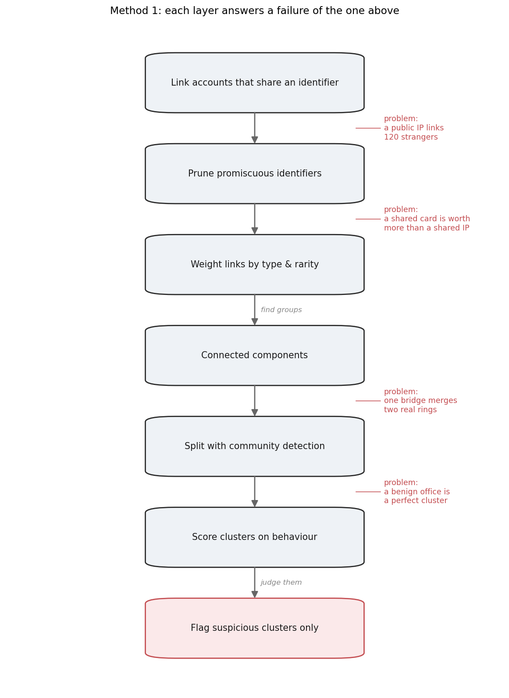
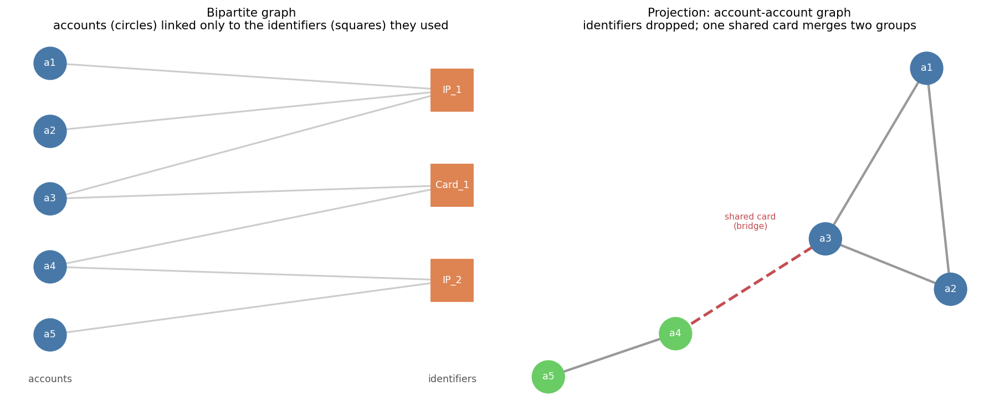
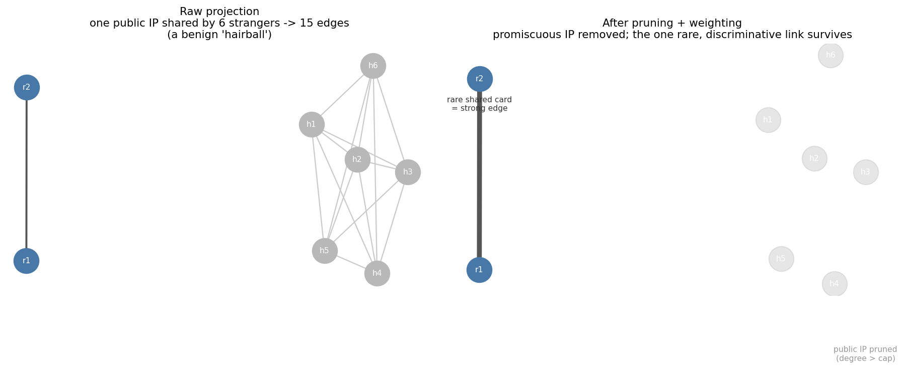
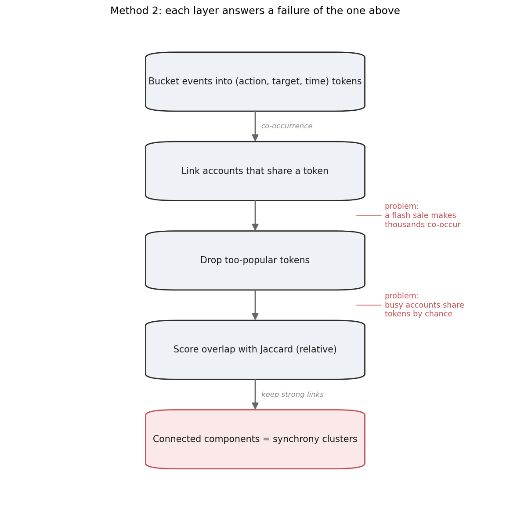

::: {.lead}
This experiment finds groups of accounts that are secretly run by one actor. It
does so two ways, and both turn a pile of accounts and events into a *graph* — a
set of dots and the links between them — and then look for tightly linked
groups. They differ only in what counts as a link. This page builds up each
method from the ground, defining terms as it goes.
:::

A few words are used throughout, so they are worth pinning down first.

- **Account** — one registered profile or user.
- **Identifier** — something an account uses that could tie it to other accounts:
  a payment card, phone number, email, device ID, or IP address.
- **Target** — the thing an account acts on: a product, listing, ticket, booking
  slot, or page.
- **Cluster** — a group of accounts that a method has linked together. A cluster
  is just "these accounts are connected"; it carries no judgement on its own.
- **Ring** — a cluster that really is one actor operating many accounts for
  abuse. The job of detection is to tell rings apart from innocent clusters.
- **Coordination** — many accounts acting together, on the same targets or at the
  same times, under one controller.
- **Synchrony** — doing the same thing at the same time. *Behavioural synchrony*,
  used in the second method, means accounts acting on the same target inside the
  same short time window.
- **Jitter** — small random timing offsets a ring adds between its accounts so
  they do not all act at the exact same instant, to look less coordinated.

## Two ways to find a group

To find coordinated groups, the experiment uses two methods that look for
different evidence:

- **Method 1 — identifier graph.** Link accounts that *reuse the same things* —
  the same card, device, or IP. It assumes that getting fresh infrastructure for
  every account costs money and effort, so rings cut corners and reuse.
- **Method 2 — behavioural synchrony.** Link accounts that *do the same thing at
  the same time* — the same action, on the same target, in the same window. It
  assumes that even a ring with fresh infrastructure still has to coordinate its
  actions to get its work done.

Each is built up in turn below; the final section sets them side by side.

## Method 1: the identifier graph, built up

Method 1 is not one idea; it is a sequence of them, each added because the
previous version failed in a specific way. It is worth seeing it built rather
than presented finished, because that is what turns "pruning, weighting,
community detection, scoring" from arbitrary machinery into a chain of answers to
concrete problems. The whole progression in one view:

{fig-alt="A vertical flowchart of seven stages from 'link accounts that share an identifier' down to 'flag suspicious clusters only', with red 'problem' annotations beside the gaps that each next stage fixes."}

### Start simple: link accounts that share an identifier

The simplest detector follows the obvious instinct: a ring is probably run from
one place, so its accounts reuse the same card, device, or connection. Link any
two accounts that used the same identifier, and the linked groups are your
candidate rings.

The clean way to express this is a **graph** — dots (**nodes**) joined by lines
(**edges**). Start with a **bipartite graph**: two kinds of node (accounts and
identifiers), with edges only ever between the two kinds, never within. An edge
means "this account used this identifier." Then **project** it: drop the
identifier nodes and draw a direct edge between any two accounts that shared one.
That account-to-account graph is the simplest detector.

{fig-alt="Left: a bipartite graph with five account circles linked to three identifier squares. Right: the projected account graph, two coloured groups joined by a dashed bridge edge labelled shared card."}

For a lazy ring that recycles a handful of cards and devices, this alone lights
it up. The shared card between `a3` and `a4` in the figure also shows a useful
side effect: it chains two groups into one component, so a ring split across
batches of accounts gets merged automatically. But that same merging is the
first thing to go wrong.

### Problem 1 — a shared identifier can link strangers → prune

The simple version breaks on benign infrastructure. A single university egress
IP used by 120 unrelated students projects into one dense 120-account blob that
looks like a huge ring. Worse, these hubs dominate the graph: the densest
clusters are often the most benign. The fix is **pruning** — drop any identifier
shared by more than a set number of accounts *before* projecting. Carrier NATs,
university egress, payment aggregators, and default or broken device IDs all live
in that tail; they connect everyone, so they discriminate no one. (The Method 1
page shows the degree-cap sweep — and that setting the cap *too* tight starts
pruning the real ring's own shared identifiers.)

### Problem 2 — surviving links are not equal → weight

Pruning removes the worst hubs, but among what survives a shared card is far
stronger evidence than a shared IP, and an identifier shared by thirty accounts
is weaker than one shared by two. Treat every surviving link equally and weak
coincidental links accumulate into false groups. The fix is **inverse-frequency
weighting**: each link's strength is its base weight (set by identifier type)
divided by the log of how many accounts share it,

$$
w \;=\; \frac{\text{base weight}(\text{identifier type})}{\log_2\!\left(1 + k\right)},
$$

with $k$ the number of accounts sharing it — the same idea as inverse document
frequency in text search, where a term shared by many is weak. Links below a
floor are dropped.

{fig-alt="Left: six grey nodes fully interconnected plus a separate pair. Right: the grey nodes faded and unconnected, the pair joined by one thick edge labelled rare shared card."}

::: {.callout-note title="Where these parameter values come from"}
The degree cap, the edge-weight floor, and the base weights are **not** universal
constants — they suit this synthetic data, whose shape we control, and a reader
cannot read off the right value for *their* data from ours. On real data you set
them by fitting to reviewed cases, or by sensitivity analysis (rerunning across a
range and watching detection *and* false positives move). The Method 1 page runs
those sweeps; read the specific numbers here as illustrative, not recommended —
especially the weights, which in practice are fit, not cited.
:::

### Find groups, then Problem 3 — one bridge can merge two real rings → community detection

With a weighted graph, a **connected component** — any set of accounts reachable
by following edges — is the natural "group." But components over-merge: a single
bridging identifier, or a chain of them, fuses two genuinely separate rings into
one sprawling component. The fix is **community detection**, which finds the
denser sub-groups inside a component and splits it.

The experiment uses **Louvain** (Blondel et al., 2008): each account is moved
into whichever neighbouring community most increases a score called *modularity*,
communities are then collapsed to single nodes, and the process repeats. It is
fast and ubiquitous, but can return communities that are not even internally
connected — which is why **Leiden** (Traag et al., 2019) exists, adding a
refinement step that guarantees connected communities and is the better default
at scale. Both optimise modularity, which carries a **resolution limit**
(Fortunato & Barthélemy, 2007): below a graph-dependent size, separate small
groups can be merged. Here the components are small and Louvain suffices; the
reference matters so anyone scaling up knows why they might switch to Leiden.

### Problem 4 — a perfect cluster can be perfectly benign → scoring

Now the clusters are clean — and a travel agency's 25 staff sharing one office IP
form a textbook-perfect cluster that is entirely innocent. Flag every cluster and
you flag them. The fix is the last layer: **scoring**. Clustering only says
*these accounts are linked*; it has no opinion on whether that is bad. A separate
scoring step judges each cluster on behaviour — a CAPTCHA-failure rate (shrunk
toward the population average so tiny clusters do not spike) and registration
burstiness — and only the suspicious ones are flagged. That clustering/scoring
split is what lets the method group the travel agent and then clear it, while
grouping a reuse ring and flagging it.

Put together — link, prune, weight, component, split, score — that is Method 1,
with every layer traceable to the failure that forced it.

## Method 2: behavioural synchrony, built up

Method 1 fails completely on a ring that buys fresh identifiers for every
account — there is nothing left to link by. Method 2 is aimed exactly there, and
like Method 1 it is best seen as a simple idea plus a series of fixes:

{fig-alt="A vertical flowchart of five stages from 'bucket events into tokens' down to 'connected components = synchrony clusters', with red 'problem' annotations beside the gaps for popular-token and chance-overlap failures."}

### Start simple: link accounts that act together

The premise is that identifiers are cheap to randomise but *coordination is not*.
Picture a ticket-scalping ring waiting for a concert to go on sale: every account
has its own card, device, and IP, so the identifier graph sees nothing — but the
moment the tickets (the **target**) are released, all the accounts hit the same
listing within the same minute or two. That shared timing is the signal. This is
the idea behind **SynchroTrap** (Cao et al., 2014), the Facebook/Instagram system
this method follows in spirit, and its predecessor **CopyCatch** (Beutel et al.,
2013).

The simplest version: compress each event into a **behavioural token** — a tuple
`(action, target, time_bucket)`, where a **time bucket** is a fixed-width slice
of time. Two accounts that produce the same token did the same thing, to the same
target, in the same window. Link accounts that share a token, and a coordinated
group surfaces.

Comparing every account to every other would not scale, so the linking is done
through an **inverted index**: think of the index at the back of a book, where
you look up "modularity" once and get the list of pages rather than reading every
page. Here the "words" are tokens and the "pages" are accounts — for each token,
the index stores the accounts that produced it, and any two accounts under the
same token are a **candidate pair**. Only candidate pairs are ever compared.

### Problem 1 — popular things create mass co-occurrence → popularity cap

Raw co-occurrence fires on the obvious false case: a flash sale, where thousands
of unrelated shoppers hit the same item in the same minute and so share a token.
That is popularity, not coordination. The fix is a **popularity cap** — drop any
token produced by more accounts than a threshold, the way you would not index the
word "the."

### Problem 2 — busy accounts share tokens by chance → relative overlap (Jaccard)

Even after dropping popular tokens, two heavy users will share a few tokens by
coincidence, and a raw shared-count rewards them for simply being active. The fix
is to measure overlap *relative to* total activity, with **Jaccard similarity**:

$$
J(A, B) \;=\; \frac{|A \cap B|}{|A \cup B|}
$$

where $A$ and $B$ are the two accounts' token sets. Two accounts that each
produced 100 tokens but share only 3 score about $3/197 \approx 0.015$ — ignored.
Two that each produced 10 and share 8 score $8/12 \approx 0.67$ — a strong link.
An edge is kept only when accounts clear both a minimum shared-token count and a
Jaccard floor; connected components of at least three accounts are the synchrony
clusters.

### Problem 3 — a ring adds jitter, and the window is a tradeoff → overlapping buckets

A careful ring does not act at the exact same instant; it adds **jitter**. If the
time bucket is narrower than the jitter, the ring's events scatter across
different buckets and it vanishes; if it is too wide, coincidental co-occurrence
from ordinary users creeps back in. Two fixes: **overlapping buckets** (a second
grid shifted half a window, so events near a boundary still share a token), and
treating the **bucket width** itself as the method's central knob, tuned
deliberately. The Method 2 page's bucket-width sweep is exactly this tradeoff
made visible.

Put together — token, inverted index, popularity cap, Jaccard, components — that
is Method 2, again with each layer answering a specific way the simpler version
fires on innocents.

::: {.callout-note title="Where these parameter values come from"}
As with Method 1, the Jaccard floor, shared-token minimum, bucket width, and
popularity cap suit this synthetic data; the right values on real traffic depend
on action type, target popularity, campaign tempo, and review cost. The Method 2
page runs the bucket-width and Jaccard sweeps so the sensitivity is visible
rather than asserted.
:::

## The two methods side by side

Both methods end in "cluster a graph," which makes them easy to confuse. The
difference is entirely in what builds the graph and what breaks each one.

| | Method 1: identifier graph | Method 2: behavioural synchrony |
|---|---|---|
| Links accounts by | shared identifiers | same action + target + time window |
| Assumes | reusing infrastructure is cheaper than renewing it | coordination is unavoidable even with fresh infrastructure |
| Catches | reuse rings (the lazy case) | coordination rings, including unique-identifier ones |
| Main false positive | benign shared infrastructure (households, offices, university egress) | benign crowds around popular targets (sales, drops, outages) |
| Key knob | pruning + edge weight (degree cap 40, min edge weight 0.8) | bucket width (1 h) + Jaccard floor (0.25) |
| Evaded by | fresh identifiers per account | spreading actions out — but that slows the campaign |

The last row is what connects them. An attacker can defeat the identifier graph
by buying fresh identifiers, and defeat synchrony by spreading actions wider than
the bucket. But spreading actions out is the same as slowing the campaign down —
so the second method does not have to *catch* every ring, only *tax*
coordination, with every increment of evasion paid for in tempo. The
implementations, the exact parameters, and the bucket-width tradeoff are on the
two method pages.
